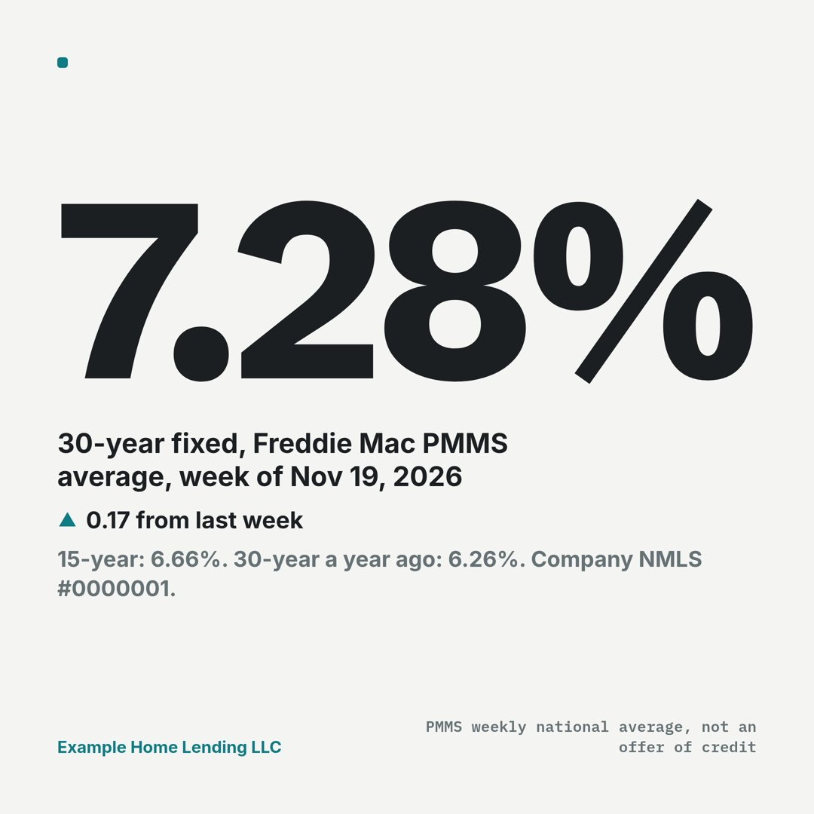

<p align="center">
  
</p>

# Mortgage Social Media Skills for Claude and Codex

<p align="center">
  
  
  
  
  
  
</p>

<!-- intro:start (maintained upstream, regenerated from the bundle data) -->
**Claude skills for mortgage broker social media and loan officer marketing.** Three skills for
loan officers and mortgage brokers: a **monthly content calendar**, a
**post writer that checks Reg Z** (trigger terms and APR), your **NMLS ID**
and the **Equal Housing** line on every post, and the **Thursday Rate Desk**:
every Thursday Freddie Mac publishes its weekly mortgage rate survey, and the
skill turns it into a rate post, a LinkedIn version for your realtor
partners and a rate card, with every number taken from the survey. Posts
land as drafts in [Publora](https://publora.com/?utm_source=mortgage-social-media-skills&utm_medium=skill&utm_content=readme)
for Facebook, Instagram, LinkedIn, Threads, X and more. Mortgage social
media post ideas included: 100+ of them.
<!-- intro:end -->

<!-- seo:start (maintained upstream, regenerated from the bundle data) -->
## Mortgage marketing on social media, checked against Reg Z

This bundle writes your own organic posts: the weekly rate post, education posts, partner posts for LinkedIn. It does not buy ads, sell leads or post for you: every post is a draft you approve. Before that, each post is checked for Reg Z trigger terms and the APR, your NMLS IDs and the Equal Housing line.
<!-- seo:end -->

<!-- family:start (maintained upstream, regenerated from the bundle data) -->
> **One of a family.** [Social Media Skills for Professionals](https://github.com/sergebulaev/social-media-skills-for-professionals) has one bundle per profession.
>
> Skills for one network instead of one profession: [LinkedIn](https://github.com/sergebulaev/linkedin-skills) · [X](https://github.com/sergebulaev/x-skills) · [Instagram](https://github.com/sergebulaev/instagram-skills) · [YouTube](https://github.com/sergebulaev/youtube-skills) · [TikTok](https://github.com/sergebulaev/tiktok-skills) · [Threads](https://github.com/sergebulaev/threads-skills) · [Facebook](https://github.com/sergebulaev/facebook-skills).
<!-- family:end -->

## What you can do

- "Write this week's rate post" -> this week's 30-year and 15-year averages
  from Freddie Mac, the change from last week and a year ago, a rate card,
  your NMLS and Equal Housing lines, drafts in Publora.
- "Check this post: Own this home for just $1,200/mo!" -> FAIL: a payment
  amount is a Reg Z trigger term; the fix drops it or adds your approved APR
  example; NMLS ID added.
- "Plan December" -> holiday closings, year-end tax documents, the FHFA
  2027 loan-limit post, four rate Thursdays, education and partner posts.
- "Turn my notes on FHA vs conventional into an Instagram carousel" ->
  slides, caption, check, draft.

### What the picture looks like

<p align="center">
  
</p>

A rate card the Rate Desk made from the Freddie Mac survey of November 19, 2026, for the fictional lender in the tests: the change from last week, a context line with the company NMLS, and "not an offer of credit", because a card gets shared without its post. The card is typeset, not drawn by a model, so the number on it is the number in the survey.

## The 3 skills

| Skill | What it does | Say |
|---|---|---|
| `mortgage-content-planner` | First run: a short interview about your lending business (saved as memory). Then a month plan: dated hooks, data posts, evergreen ideas, network and format per post | "Plan my posts for next month" |
| `mortgage-post-writer` | A post per network in your voice, the Reg Z and NMLS check with every fix shown, a data card or your photo, a draft in Publora | "Write a post for first-time buyers about down payment help" |
| `mortgage-rate-desk` | **Thursday Rate Desk.** Every Thursday Freddie Mac publishes the weekly mortgage rate survey. The skill reads it, compares it with last week and last year, and drafts a rate post, a partner version for LinkedIn and a rate card, each passing the Reg Z, NMLS and Equal Housing check. | "Write this week's rate post" |

<!-- quick-answers:start (maintained upstream, regenerated from the bundle data) -->
## Quick answers

### What should mortgage loan officers and mortgage brokers post on social media?

Posts that start from data your clients care about: this week's rate post (Thursday, Freddie Mac PMMS), the yearly loan-limit post. Add rates and the market, first-time buyers, loan types explained, process, documents and credit. The skill has 120 post ideas and a calendar for the year.

### What rules apply to mortgage loan officer social media posts?

The main checks are Reg Z and NMLS, plus the FTC rules on reviews and endorsements. Each post is checked before it becomes a draft; the list is below.

### Is there an AI tool for mortgage loan officer social media?

Mortgage Social Media Skills is a free, open-source skill bundle for Claude and Codex. Rate posts from Freddie Mac PMMS with a Reg Z and NMLS check, a monthly plan, and drafts in Publora.
<!-- quick-answers:end -->

## Start in Claude Desktop (no coding)

1. Make a folder for your lending business's social media, for example `Social`.
2. In Claude Desktop open **Customize**, **Plugins**, **Add**, **Add
   marketplace**, **Add from a repository**, paste
   `sergebulaev/mortgage-social-media-skills` and install the plugin.
3. Optional: connect the **Publora** connector (drafts and scheduling) and
   the **Pixfaro** connector (data cards) under Customize, Connectors.
4. Start a session in your `Social` folder and say: **"Plan my posts for next month"**.

## Other ways to install

**Claude Code**

```
/plugin marketplace add sergebulaev/mortgage-social-media-skills
/plugin install mortgage-social-media-skills@mortgage-social-media-skills
```

**Codex CLI**

```bash
codex plugin marketplace add sergebulaev/mortgage-social-media-skills
codex plugin add mortgage-social-media-skills@mortgage-social-media-skills
```

**claude.ai (web)**: Customize, Plugins, Add marketplace,
`sergebulaev/mortgage-social-media-skills`.

**Any agent that reads SKILL.md (OpenClaw and others)**

```bash
npx skills add sergebulaev/mortgage-social-media-skills
```

## Where it runs

| Where | Status | Notes |
|---|---|---|
| Claude Code | verified | `claude plugin validate` passes; the behaviour evals run here (Claude Code 2.1, a fake Publora, 6 cases × 2 runs, 12 of 12 passed on 2026-11-24); `claude plugin marketplace add` + `install` from this public repo checked on 2026-11-26 |
| Any agent through `npx skills add` (Codex, Cursor, OpenClaw and others) | install verified | installs as one skill that routes to the three (checked on the public repo 2026-11-26); behaviour tested only in Claude Code |
| Claude Desktop and claude.ai | limited | the same plugin, not yet tested end to end. Reading the Freddie Mac rate survey needs network access from the session; if it is blocked, paste the numbers and the skill works from them |
| Codex CLI as a plugin | install verified | `codex plugin marketplace add` + `codex plugin add` install the three skills (Codex CLI 0.148, 2026-11-26); behaviour tested only in Claude Code |
| Autopilot on GitHub Actions | limited | tested offline with saved feed data and a dry run; your copy's first run is the live test (run it once with `dry_run: true`) |

## What it needs

| You have | What works |
|---|---|
| Nothing but Claude or Codex | memory, monthly plans, posts with the compliance check, the signature skill with data you paste; you copy the final text |
| A Publora personal account (the [free Starter plan](https://publora.com/pricing?utm_source=mortgage-social-media-skills&utm_medium=skill&utm_content=readme) is enough to start: 3 accounts, 15 posts a month; Pro for more) | drafts land in Publora with the picture attached; scheduling after your yes; the autopilot |
| Optional, for pictures: a Pixfaro key or connector ($1 free credit) | data cards for posts (about $0.02 each); without it the post goes out with your own photo or none |
| Optional: an Anthropic API key | the autopilot writes with Claude instead of templates |

Publora plans on [publora.com/pricing](https://publora.com/pricing?utm_source=mortgage-social-media-skills&utm_medium=skill&utm_content=readme) (read
2026-11-19): Starter free forever (3 social accounts, 15 posts a month, 3
scheduled at a time up to 7 days ahead, all networks except X); Pro from $5.99
per account a month.

## Rules it checks

- Reg Z advertising rules (12 CFR 1026.24): trigger terms, APR with any rate offer.
- Rate posts quote the Freddie Mac survey as market news with a not-an-offer label. That is the bundle's reading, not settled law: confirm it once with your compliance team.
- NMLS ID of the loan officer and the company; the Equal Housing line on every post by default ("Equal Housing Opportunity" unless your profile says otherwise; `equal_housing_line: off` switches it off).
- Reg N / MAP Rule (12 CFR 1014.3(q), (n)): no guaranteed approval, no implied government affiliation.
- RESPA §8 for realtor co-marketing; fair lending wording.
- FTC reviews and endorsements rules for testimonials; no invented numbers.

The rules are the bundle's reading of public sources, each with its source
and the date it was checked (`references/compliance.md`, verified
2026-11-19, reviewed quarterly). **Not legal advice; you are responsible
for your posts.**

## Autopilot: posts while you work

`.github/workflows/autopilot.yml` watches the Freddie Mac weekly mortgage rate survey (PMMS) on a schedule
and leaves **drafts** in Publora, never live posts. Make your own copy (Use this template, Private), add
`autopilot/config.json` and the `PUBLORA_API_KEY` secret, done. In a public copy or fork the
config (business name, license line, area) is public too. Details:
`references/autopilot.md`. No model key? It writes from templates (`--no-llm`).

## Memory

Your business lives in `./mortgage-memory/` in your working folder:
profile (city, ZIPs, state, NMLS IDs, licensed states, the Equal Housing line), voice, rules, facts,
ideas, lessons, consent. Plain markdown. Keep it private.

<!-- post-ideas:start (maintained upstream, regenerated from the bundle data) -->
## Post ideas for December 2026

10 of this month's mortgage social media post ideas. Each is a starting line: the skill fills it with the month's data, writes it in your voice and checks it before it becomes a draft.

**Dates and data in December:** Year-end closings and holiday closing calendars; tax documents to keep; new limits on Jan 1.

- Rates moved but your plan didn't: why a pre-approval is still the first step.
- How the 10-year Treasury and mortgage rates relate, no forecast.
- Rate shopping: why several quotes in a short window count as one inquiry for most scoring models.
- "Renting while saving": five documents to start collecting now.
- Earnest money vs down payment.
- Homebuyer education classes in your area (dates from the class provider).
- FHA loans: insured by the government, made by lenders like us.
- Condo financing: why the building matters too.
- Refinance: rate-and-term vs cash-out, in plain words.
- "Which loan is right for me?" A decision card with questions, not answers.

All 100+ ideas: `references/post-ideas.md`. Dates for the year: `references/calendar.md`.
<!-- post-ideas:end -->

## Where the ideas come from

- **Freddie Mac PMMS**, weekly on Thursday (the Rate Desk, automatic).
- **FHFA conforming loan limits**, every late November for the next year.
- **CFPB newsroom**, Fed meeting dates, the home-buying season calendar.
- Your own: closings (with consent), pre-approval milestones, partner events.

Full list with URLs, schedules and the manual fallback: `references/sources.md`.
100+ post ideas: `references/post-ideas.md`. Year calendar: `references/calendar.md`.

<details>
<summary>For developers</summary>

- Runtime is Python standard library only. `lib/` holds the compliance lint
  (`lib/compliance.py` + `references/compliance-rules.json`), the number check
  (`lib/provenance.py`), feed parsers (`lib/feeds/`), Publora and Pixfaro
  clients, memory helpers.
- `python3 scripts/check_post.py post.txt --memory ./mortgage-memory --source data.json --fix`
- `python3 -m unittest discover -s tests` (offline), `python3 evals/run_evals.py --list`
  (behaviour evals against a fake Publora, needs the `claude` CLI).
- Part of a family of vertical social media skill bundles sharing one core;
  shared files are listed in `.vertical-core.json`.

</details>

---

MIT License.

Built by [Serge Bulaev](https://github.com/sergebulaev), founder of [Publora](https://publora.com/?utm_source=mortgage-social-media-skills&utm_medium=skill&utm_content=readme).
